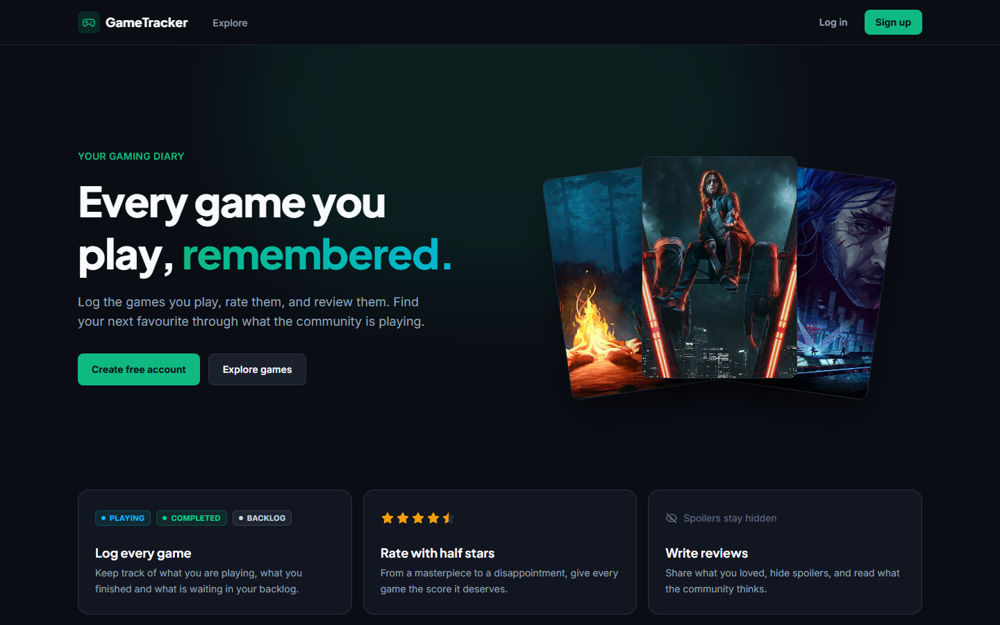
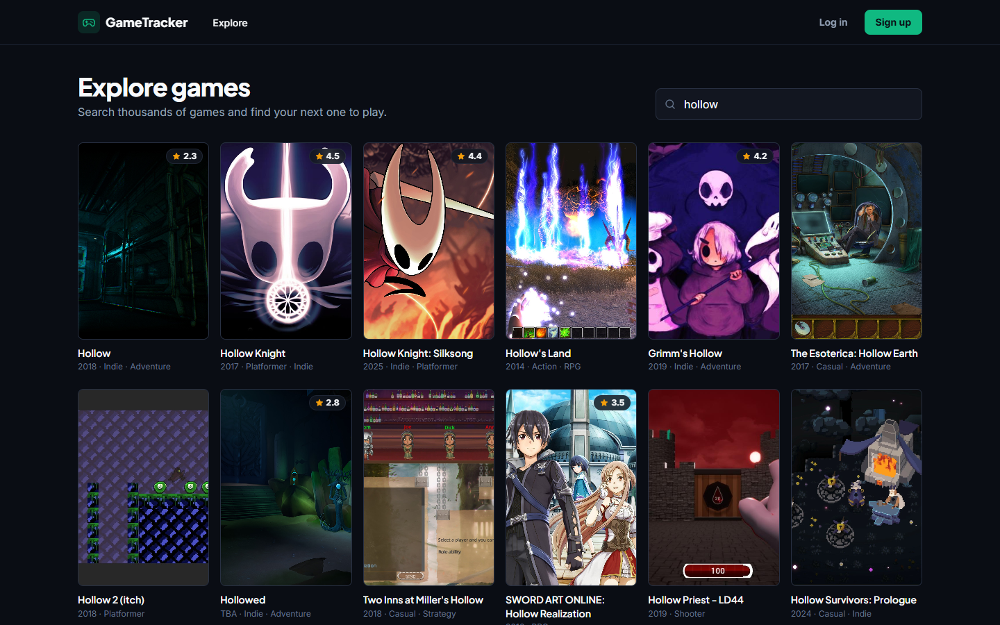
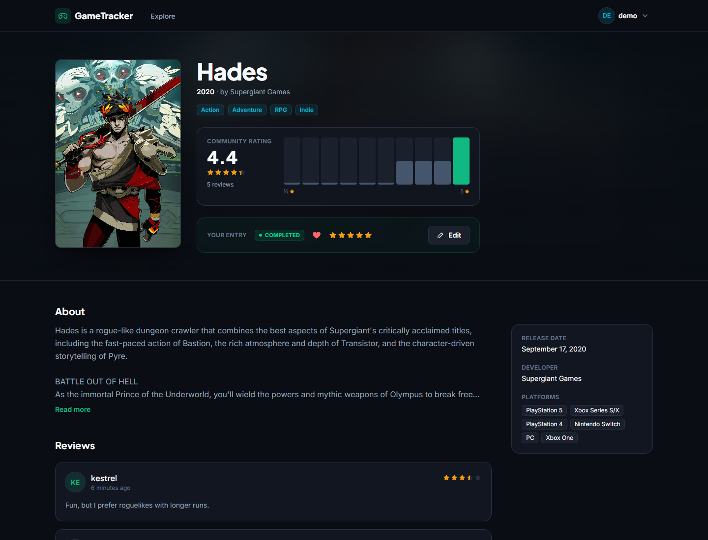
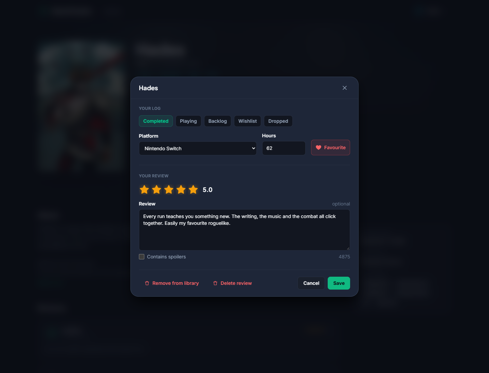
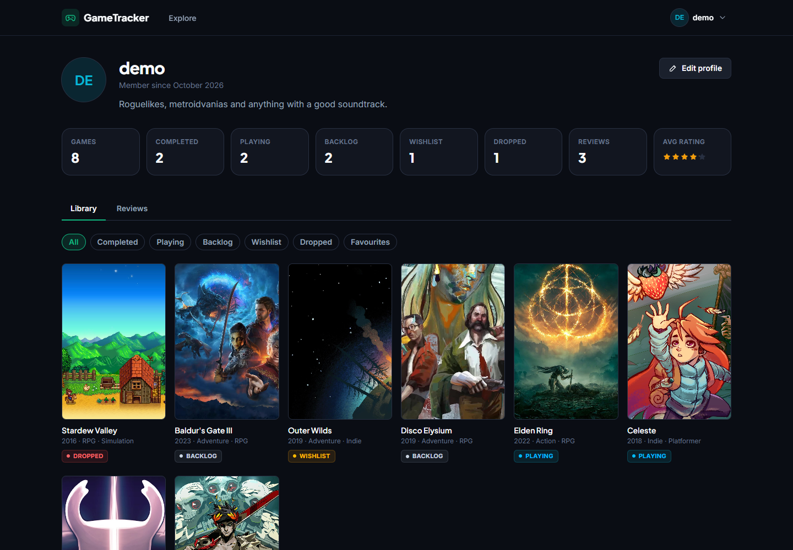
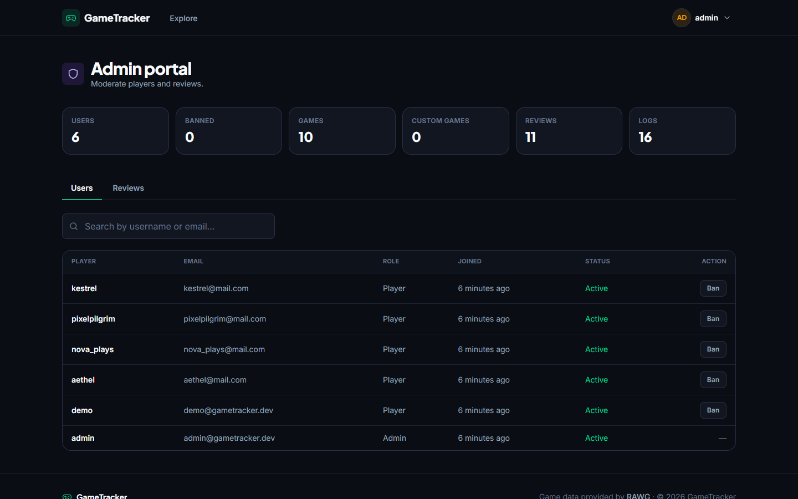
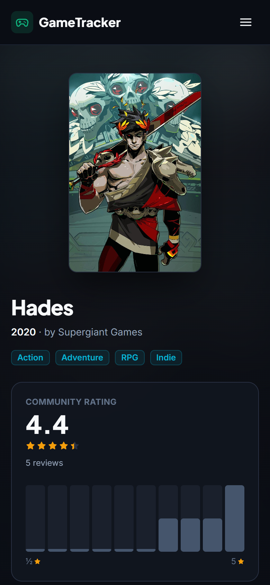
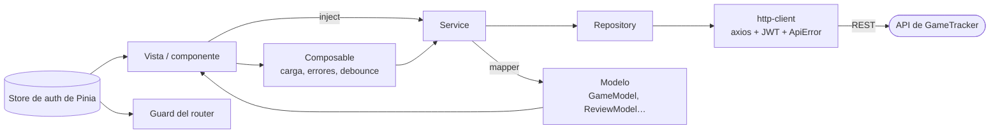
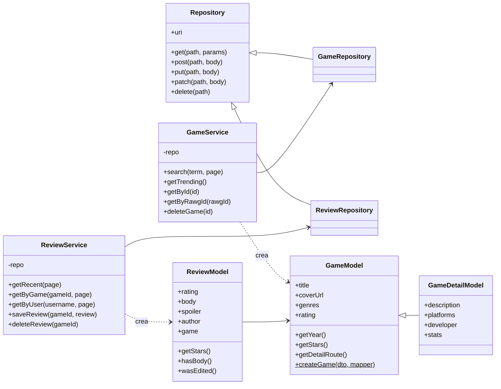

# GameTracker · Frontend

Aplicación web de **GameTracker**, un diario de videojuegos al estilo de Letterboxd: registra los juegos a los que juegas, puntúalos con medias estrellas, escribe reseñas y descubre a qué está jugando la comunidad.

Construida con **Vue 3**, **Pinia**, **Vue Router** y **Tailwind CSS**, testeada con **Vitest**. Se comunica con la [API REST de GameTracker](https://github.com/joseang1/gametracker-backend).

| | |
|---|---|
| Repositorio del backend | [joseang1/gametracker-backend](https://github.com/joseang1/gametracker-backend) |
| Presentación | _enlace pendiente de añadir antes de la entrega_ |
| Diseño | Maquetas en Figma: _enlace pendiente de añadir antes de la entrega_ |



---

## Índice

1. [Funcionalidades](#funcionalidades)
2. [Capturas de pantalla](#capturas-de-pantalla)
3. [Stack tecnológico](#stack-tecnológico)
4. [Puesta en marcha](#puesta-en-marcha)
5. [Arquitectura](#arquitectura)
6. [Testing](#testing)
7. [Metodología de trabajo](#metodología-de-trabajo)

---

## Funcionalidades

- **Página de inicio** con los juegos en tendencia, las últimas reseñas de la comunidad y accesos claros para los invitados.
- **Explorar** miles de juegos: búsqueda mientras escribes, paginación numerada y la búsqueda guardada en la URL para que los enlaces y el botón Atrás funcionen.
- **Ficha del juego** con portada, descripción, plataformas, nota de la comunidad y un histograma de puntuaciones, además de reseñas paginadas con protección de spoilers.
- **Registrar, puntuar y reseñar** desde un modal: estado (jugando, completado, pendiente, lista de deseos, abandonado), plataforma, horas, favorito, puntuación con medias estrellas, texto de la reseña y aviso de spoilers.
- **Perfiles** con estadísticas por estado, una biblioteca filtrable, las reseñas del usuario y edición del perfil con vista previa del avatar en tiempo real.
- **Panel de administración**: estadísticas del sitio, búsqueda de jugadores, banear y desbanear, moderación de reseñas y borrado de juegos.
- **Cuentas**: registro e inicio de sesión con una validación que replica la del backend. La sesión se mantiene al recargar y termina automáticamente si el token caduca o el usuario es baneado.
- **Responsive** desde móviles hasta pantallas anchas, con soporte de teclado y lectores de pantalla (controles con etiqueta, gestión del foco en los modales, `aria-current`, regiones live).

| Rol | Qué ve |
|---|---|
| Invitado | Inicio, Explorar, fichas de juegos, reseñas y perfiles |
| Usuario | Además, registrar, puntuar y reseñar juegos y editar su perfil |
| Admin | Además, el panel de administración y el borrado de juegos |

---

## Capturas de pantalla

| Explorar | Ficha del juego |
|---|---|
|  |  |

| Registrar y reseñar | Perfil |
|---|---|
|  |  |

| Panel de administración | Móvil |
|---|---|
|  |  |

---

## Stack tecnológico

| Área | Tecnología |
|---|---|
| Framework | Vue 3.5 (`<script setup>`, Composition API) · Vite 8 |
| Estado | Pinia (setup stores) |
| Rutas | Vue Router 5 con rutas de carga diferida y guards de navegación |
| HTTP | Axios con interceptores de petición y de respuesta |
| Estilos | Tailwind CSS 4 con los tokens del sistema de diseño del proyecto |
| Tests | Vitest · Vue Test Utils · @pinia/testing · jsdom · cobertura v8 |

---

## Puesta en marcha

### Requisitos

- **Node.js 22.18+ o 24.12+**
- El **[backend](https://github.com/joseang1/gametracker-backend)** arrancado en `http://localhost:8080` (ver su README)

### Instalar y arrancar

```bash
git clone https://github.com/joseang1/gametracker-frontend.git
cd gametracker-frontend
npm install
npm run dev
```

Abre **http://localhost:5173**.

### Cuentas de demostración

Las crea el backend en su primer arranque:

| Usuario | Contraseña | Rol |
|---|---|---|
| `admin` | `admin1234` | Admin |
| `demo` | `demo1234` | Usuario |

### Configuración

`.env` contiene los valores por defecto. Para cambiarlos en local, crea un `.env.local` (ignorado por git):

| Variable | Valor por defecto | Para qué sirve |
|---|---|---|
| `VITE_APP_TITLE` | `GameTracker` | Nombre de la aplicación |
| `VITE_APP_API_URL` | `http://localhost:8080/api/v1` | URL base del backend |

### Scripts

| Comando | Qué hace |
|---|---|
| `npm run dev` | Servidor de desarrollo con recarga en caliente |
| `npm run build` | Build de producción en `dist/` |
| `npm run preview` | Sirve el build de producción |
| `npm run test:unit` | Tests en modo watch |
| `npm run test:coverage` | Todos los tests una vez, con el informe de cobertura y sus umbrales |

---

## Arquitectura

```
src
├── core                 JavaScript puro, sin Vue
│   ├── http             cliente axios, cabecera JWT, ApiError, almacenamiento del token
│   ├── models           clase base Repository y modelos del dominio (GameModel, ReviewModel…)
│   ├── mappers          DTO del backend → modelo, una función por campo
│   ├── apis             un Repository + Service por recurso (auth, games, reviews, game-logs, users, admin)
│   ├── validators       reglas de formulario que replican las del backend
│   ├── formatters       fechas relativas, fechas de lanzamiento
│   └── pagination       ventana de páginas para la paginación numerada
├── composables          lógica reutilizable: useAsync, useFormSubmit, useGameSearch, useDisclosure, useClickOutside
├── stores               store de autenticación de Pinia
├── router               rutas, guards, redirecciones seguras
├── components           ui · layout · games · reviews · library · profile · auth
└── views                una por página
```

### Flujo de datos



- **Los services se crean una sola vez en `main.js`** y se entregan a la app con `app.provide`. Las vistas los obtienen con `inject`, así que los tests pueden pasar services falsos.
- **Los mappers y los modelos** concentran en un solo sitio la forma del JSON del backend. Los componentes solo usan modelos y sus métodos, como `game.getStars()` o `game.getDetailRoute()`.
- **Cada error de la API se convierte en un `ApiError`** con `status`, `message` y `errors` por campo, para que los formularios muestren los mensajes del backend debajo del campo correcto.
- **Sesión:** el JWT se guarda en `localStorage`, se añade a cada petición y se restaura al arrancar. Un `401` en una petición que llevaba token cierra la sesión automáticamente.

### Capa core



Auth, registros de juego, usuarios y admin siguen el mismo patrón Repository → Service → Model.

---

## Testing

```bash
npm run test:coverage
```

**317 tests** en 47 archivos, con un **96 % de cobertura de líneas**. La ejecución falla si la cobertura baja de los umbrales de `vitest.config.js` (90 % de líneas, 85 % de ramas).

Los tests están en `tests/`, con la misma estructura que `src/`:

| Qué | Ejemplos |
|---|---|
| Lógica del core | mappers y modelos, services con repositories falsos, validadores, la ventana de paginación, formateadores de fechas |
| Composables | debounce y respuestas desordenadas en `useGameSearch`, errores de `useFormSubmit`, `useDisclosure` y la tecla `Escape` |
| Componentes | portada alternativa de `GameCard`, medias estrellas y teclado en `StarRatingInput`, foco y cierre de `AppModal`, validación y borrado con confirmación en `LogGameForm` |
| Vistas | estados de carga, vacío, error y éxito de cada página, estado en la URL, interfaz según el rol, la redirección del id de RAWG al id propio |
| Router y store | guards para invitados, usuarios y admins, redirecciones seguras tras el login, restauración de la sesión |

---

## Metodología de trabajo

- **Ramas:** `main` contiene la versión entregada. `dev` es la rama de integración. Cada historia de JIRA se desarrolla en su propia rama (`feature/FE-205-catalog`, `test/FE-211-coverage-gaps`…) y se fusiona en `dev` con `--no-ff`.
- **Commits** siguiendo [Conventional Commits](https://www.conventionalcommits.org/).
- **Planificación** en JIRA: el frontend fue el Sprint 2, historias de FE-201 a FE-211.

---

Hecho por **Jose Ángel Peña Díaz** como proyecto final del bootcamp full-stack de Factoría F5 · P5 Digital Academy. Datos de juegos proporcionados por [RAWG](https://rawg.io).
