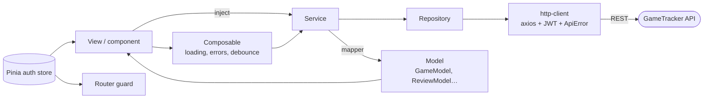

# GameTracker · Frontend

Web app for **GameTracker**, a Letterboxd-style diary for video games: log the games you play, rate them with half stars, write reviews and follow what the community is playing.

Built with **Vue 3**, **Pinia**, **Vue Router** and **Tailwind CSS**, tested with **Vitest**. It talks to the [GameTracker REST API](https://github.com/joseang1/gametracker-backend).

| | |
|---|---|
| Backend repository | [joseang1/gametracker-backend](https://github.com/joseang1/gametracker-backend) |
| Presentation | _link added before submission_ |
| Design | Figma mockups: _link added before submission_ |


---

## Table of contents

1. [Features](#features)
2. [Screenshots](#screenshots)
3. [Tech stack](#tech-stack)
4. [Getting started](#getting-started)
5. [Architecture](#architecture)
6. [Testing](#testing)
7. [Workflow](#workflow)

---

## Features

- **Landing page** with trending games, recent community reviews and clear entry points for guests.
- **Explore** thousands of games: search as you type, numbered pagination, and the search kept in the URL so links and the Back button work.
- **Game page** with cover, description, platforms, community rating and a rating histogram, plus paginated reviews with spoiler protection.
- **Log, rate and review** from a modal: status (playing, completed, backlog, wishlist, dropped), platform, hours, favourite, half-star rating, review text and spoiler flag.
- **Profiles** with stats per status, a filterable library, the user's reviews and profile editing with a live avatar preview.
- **Admin portal**: site statistics, player search, ban and unban, review moderation and game deletion.
- **Accounts**: register and log in with validation that mirrors the backend. The session survives reloads and ends automatically if the token expires or the user is banned.
- **Responsive** from phones to wide screens, with keyboard and screen-reader support (labelled controls, focus handling in modals, `aria-current`, live regions).

| Role | What they see |
|---|---|
| Guest | Landing, Explore, game pages, reviews and profiles |
| User | Plus logging, rating, reviewing and editing their profile |
| Admin | Plus the admin portal and game deletion |

---

## Screenshots

| Explore | Game page |
|---|---|
|  |  |

| Log and review | Profile |
|---|---|
|  |  |

| Admin portal | Mobile |
|---|---|
|  |  |

---

## Tech stack

| Area | Technology |
|---|---|
| Framework | Vue 3.5 (`<script setup>`, Composition API) · Vite 8 |
| State | Pinia (setup stores) |
| Routing | Vue Router 5 with lazy-loaded routes and navigation guards |
| HTTP | Axios with request and response interceptors |
| Styling | Tailwind CSS 4 with design tokens from the project's design system |
| Tests | Vitest · Vue Test Utils · @pinia/testing · jsdom · v8 coverage |

---

## Getting started

### Requirements

- **Node.js 22.18+ or 24.12+**
- The **[backend](https://github.com/joseang1/gametracker-backend)** running on `http://localhost:8080` (see its README)

### Install and run

```bash
git clone https://github.com/joseang1/gametracker-frontend.git
cd gametracker-frontend
npm install
npm run dev
```

Open **http://localhost:5173**.

### Demo accounts

Created by the backend on its first start:

| Username | Password | Role |
|---|---|---|
| `admin` | `admin1234` | Admin |
| `demo` | `demo1234` | User |

### Configuration

`.env` holds the defaults. To override them locally, create `.env.local` (ignored by git):

| Variable | Default | Purpose |
|---|---|---|
| `VITE_APP_TITLE` | `GameTracker` | App name |
| `VITE_APP_API_URL` | `http://localhost:8080/api/v1` | Backend base URL |

### Scripts

| Command | What it does |
|---|---|
| `npm run dev` | Development server with hot reload |
| `npm run build` | Production build in `dist/` |
| `npm run preview` | Serve the production build |
| `npm run test:unit` | Tests in watch mode |
| `npm run test:coverage` | All tests once, with the coverage report and thresholds |

---

## Architecture

```
src
├── core                 plain JavaScript, no Vue
│   ├── http             axios client, JWT header, ApiError, token storage
│   ├── models           Repository base class and domain models (GameModel, ReviewModel…)
│   ├── mappers          backend DTO → model, one function per field
│   ├── apis             one Repository + Service per resource (auth, games, reviews, game-logs, users, admin)
│   ├── validators       form rules that mirror the backend
│   ├── formatters       relative dates, release dates
│   └── pagination       page window for numbered pagination
├── composables          reusable logic: useAsync, useFormSubmit, useGameSearch, useDisclosure, useClickOutside
├── stores               Pinia auth store
├── router               routes, guards, safe redirects
├── components           ui · layout · games · reviews · library · profile · auth
└── views                one per page
```

### Data flow



- **Services are created once in `main.js`** and given to the app with `app.provide`. Views get them with `inject`, so tests can pass fake services.
- **Mappers and models** keep the backend's JSON shape in one place. Components only use models and their helpers, like `game.getStars()` or `game.getDetailRoute()`.
- **Every API error becomes an `ApiError`** with `status`, `message` and per-field `errors`, so forms show backend messages under the right field.
- **Session:** the JWT is stored in `localStorage`, attached to every request, and restored on startup. A `401` on a request that carried a token ends the session automatically.

### Core layer


Auth, game logs, users and admin follow the same Repository → Service → Model pattern.

---

## Testing

```bash
npm run test:coverage
```

**317 tests** in 47 files, with **96% line coverage**. The run fails if coverage drops below the thresholds in `vitest.config.js` (90% lines, 85% branches).

Tests live in `tests/`, mirroring `src/`:

| What | Examples |
|---|---|
| Core logic | mappers and models, services with fake repositories, validators, the pagination window, date formatters |
| Composables | debounce and out-of-order responses in `useGameSearch`, `useFormSubmit` errors, `useDisclosure` and `Escape` |
| Components | `GameCard` cover fallback, `StarRatingInput` half stars and keyboard, `AppModal` focus and closing, `LogGameForm` validation and confirmed deletes |
| Views | every page's loading, empty, error and success states, URL state, role-based UI, the RAWG-to-id redirect |
| Router and store | guards for guests, users and admins, safe redirects after login, session restore |

---

## Workflow

- **Branches:** `main` holds the delivered version. `dev` is the integration branch. Each JIRA story is built on its own branch (`feature/FE-205-catalog`, `test/FE-211-coverage-gaps`…) and merged into `dev` with `--no-ff`.
- **Commits** follow [Conventional Commits](https://www.conventionalcommits.org/).
- **Planning** in JIRA: the frontend was Sprint 2, stories FE-201 to FE-211.

---

Made by **Jose Ángel Peña Díaz** as the final project of the Factoría F5 · P5 Digital Academy full-stack bootcamp. Game data provided by [RAWG](https://rawg.io).
